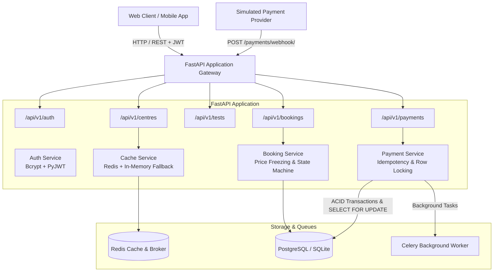
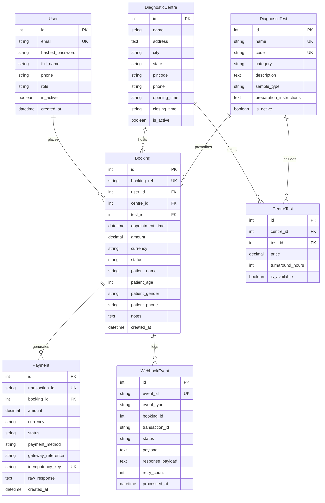
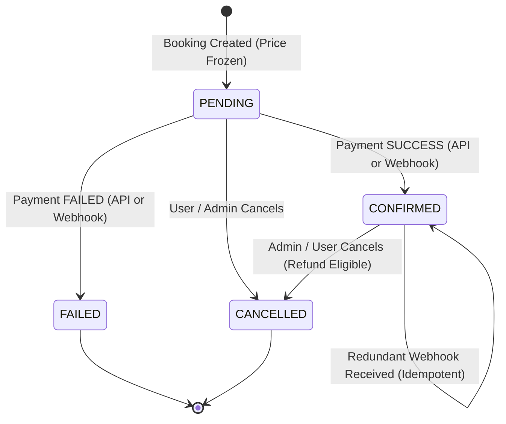

# EVE Healthcare — SDE Intern Backend Engineering Assignment

[](https://www.python.org/)
[](https://fastapi.tiangolo.com/)
[]()
[](https://www.docker.com/)
[]()

> A production-grade backend service for **Diagnostic Test Bookings**, **Simulated Payment Processing**, and **Guaranteed Idempotent Webhook Handling**, built for the EVE Healthcare SDE Intern Backend Assignment.

**Candidate**: Divyanshu Shukla

---

## 📑 Table of Contents
1. [Architectural Overview](#-architectural-overview)
2. [Key Features & System Design](#-key-features--system-design)
3. [Technology Stack](#-technology-stack)
4. [Database Modeling & Schema](#-database-modeling--schema)
5. [Booking State Machine](#-booking-state-machine)
6. [Idempotent Webhook Architecture](#-idempotent-webhook-architecture)
7. [Edge Cases Thoughtfully Handled](#-edge-cases-thoughtfully-handled)
8. [Optional Bonus Features Implemented](#-optional-bonus-features-implemented)
9. [API Documentation & Endpoints](#-api-documentation--endpoints)
10. [Quickstart & Running Locally](#-quickstart--running-locally)
11. [Running with Docker & Docker-Compose](#-running-with-docker--docker-compose)
12. [Running the Test Suite](#-running-the-test-suite)
13. [Interactive Web Portal & Webhook Lab](#-interactive-web-portal--webhook-lab)

---

## 🏛 Architectural Overview

The system follows **Clean Architecture** patterns, separating concerns into routing, business service layer, data persistence, schema validation, and async background workers:



---

## ✨ Key Features & System Design

### 1. Authentication & Security
* **JWT-Based Authentication**: Secure Bearer tokens signed with HMAC-SHA256 (`HS256`) and configurable expiration.
* **Password Hashing**: Direct `bcrypt` with unique salts to eliminate plaintext exposure.
* **Role-Based Access Control (RBAC)**: Distinguishes between `PATIENT` (regular users who can book tests and view their own bookings) and `ADMIN` / `STAFF` (who can manage centres, add tests, and update prices).
* **User Isolation**: Patients can never view, cancel, or pay for bookings created by other patients.

### 2. Diagnostic Centres & Tests
* **Many-to-Many Dynamic Pricing**: Diagnostic centres and tests are decoupled via the `CentreTest` association table. This models the real-world healthcare requirement where different centres charge different prices for the same diagnostic test (e.g. ₹350 in Bengaluru vs ₹420 in Mumbai) or have different turnaround times.
* **Search & Filters**: Search centres by name, city, address, or specific test offerings with pagination.

### 3. Diagnostic Booking System
* **Price Freezing**: When a booking is created, the current test price at that centre is permanently captured and frozen on the `Booking` entity, preventing price mutation issues if test catalog prices change later.
* **Slot & Operating Hours Validation**: Validates that appointments are in the future and strictly within centre operating hours (e.g. between 07:00 and 20:00).
* **Booking Reference**: Human-friendly reference codes generated automatically (e.g. `EVE-20260928-A1B2C3`).

### 4. Simulated Payment Service (`POST /payments/`)
* Supports multiple payment modes (`CARD`, `UPI`, `NETBANKING`, `WALLET`).
* Configurable simulation outcome (`SUCCESS` or `FAILED`).
* On `SUCCESS`, atomically transitions booking state to `CONFIRMED`.
* On `FAILED`, transitions booking state to `FAILED`.
* Enforces client idempotency via optional `idempotency_key` headers.
* **Price Tampering Protection**: Verifies payment amount strictly matches the frozen booking price.

### 5. Idempotent Payment Webhook (`POST /payments/webhook/`)
* **Strict Idempotency Guarantee**: Accepts payment-status updates from the simulated provider. If the same `event_id` is sent multiple times (network retries, replays, or concurrent hits), the endpoint **never duplicates payments**, **never duplicates bookings**, and **never corrupts booking state**.
* **Row-Level Database Locking**: Uses `with_for_update()` on SQL databases to prevent race conditions during concurrent webhook deliveries.
* **Out-of-Order Safety**: A delayed `FAILED` webhook will **never** overturn or regress an already `CONFIRMED` booking.
* **Signature Verification**: Validates HMAC-SHA256 signatures via `X-Eve-Signature` header.

---

## 🛠 Technology Stack

| Layer | Technology | Rationale |
| :--- | :--- | :--- |
| **Language** | Python 3.11+ | Modern type hints, high performance, robust ecosystem |
| **Framework** | FastAPI (0.110+) | High performance async ASGI framework with auto-generated OpenAPI/Swagger |
| **Validation** | Pydantic v2 | High-speed Rust-backed schema validation and serialization |
| **ORM / Database** | SQLAlchemy 2.0 | Clean ORM with unified support for SQLite (dev/test) & PostgreSQL (prod) |
| **Database** | PostgreSQL 16 / SQLite | Relational integrity, ACID transactions, and row-level locking |
| **Authentication** | PyJWT & Bcrypt | Industry-standard stateless token authentication and secure hashing |
| **Caching** | Redis 7 + In-Memory Fallback | Sub-millisecond response caching with seamless zero-dependency fallback |
| **Task Queue** | Celery 5.3+ / BackgroundTasks | Asynchronous email/SMS dispatch and exponential-backoff retries |
| **Rate Limiter** | SlowAPI | IP and user-based throttling to defend against brute force and DDoS |
| **Testing** | Pytest 8.0 & HTTPX | 28 automated unit and integration tests covering edge cases |
| **Containerization**| Docker & Docker-Compose | Multi-container setup (API + PostgreSQL + Redis + Celery Worker) |

---

## 🗄 Database Modeling & Schema



---

## 🔄 Booking State Machine



### State Transition Matrix & Rules:
1. **PENDING**: Initial state. Appointment reserved, price captured. Ready for payment.
2. **CONFIRMED**: Payment confirmed. Double payments strictly blocked.
3. **FAILED**: Payment simulation failed. User can retry or create a new booking.
4. **CANCELLED**: Booking cancelled. Cannot process payment for cancelled bookings. Cannot cancel an already cancelled booking.

---

## ⚡ Idempotent Webhook Architecture

Webhook delivery systems commonly suffer from **at-least-once delivery guarantees**, network retries, and worker timeouts that cause identical webhook events to hit the backend multiple times.

```mermaid
sequenceDiagram
    autonumber
    actor Provider as Payment Provider
    participant Webhook as POST /payments/webhook/
    participant DB as Database (SQLAlchemy)
    participant Worker as Background Tasks

    Provider->>Webhook: Webhook Event (event_id="evt_123", status="SUCCESS")
    
    rect rgb(20, 30, 45)
        Note over Webhook,DB: Idempotency Check
        Webhook->>DB: Query WebhookEvent WHERE event_id = "evt_123"
        alt Event Already Exists (DUPLICATE)
            DB-->>Webhook: Record Found
            Webhook-->>Provider: HTTP 200 OK (status="already_processed", is_duplicate=true)
            Note over Webhook,Provider: No duplicate payment, no booking mutation!
        else New Event (FIRST TIME)
            Webhook->>DB: SELECT Booking FOR UPDATE (Row Lock)
            Webhook->>DB: Verify Amount == booking.amount
            Webhook->>DB: Update Booking Status -> CONFIRMED
            Webhook->>DB: Insert Payment Record
            Webhook->>DB: Insert WebhookEvent ("evt_123", status="PROCESSED")
            Webhook->>DB: COMMIT Transaction
            Webhook->>Worker: Dispatch Confirmation Email & SMS
            Webhook-->>Provider: HTTP 200 OK (status="processed", is_duplicate=false)
        end
    end
```



---

## 🛡 Edge Cases Thoughtfully Handled

| Edge Case | Implementation & Defense Mechanism | HTTP Code |
| :--- | :--- | :---: |
| **Duplicate Webhook Delivery** | Checked against `webhook_events.event_id` unique index before mutating state. Returns `already_processed`. | `200 OK` |
| **Concurrent Webhook Hits** | Handled with DB row locking (`with_for_update()`) and database unique constraints. | `200 OK` |
| **Price Tampering** | Verifies `request.amount == booking.amount`. Mismatched amounts are rejected. | `400 Bad Request` |
| **Double Payment on Confirmed Booking** | Checked before processing payment. Prevents duplicate charges. | `400 Bad Request` |
| **Payment for Cancelled Booking** | Explicit status check prevents collecting payment on cancelled bookings. | `400 Bad Request` |
| **Past Appointment Dates** | Pydantic v2 `@field_validator` rejects any appointment date in the past. | `422 Unprocessable` |
| **Outside Operating Hours** | Rejects booking appointments outside centre opening/closing hours. | `400 Bad Request` |
| **Test Not Offered at Centre** | Checks `CentreTest` availability. If centre does not offer test, returns clear error. | `400 Bad Request` |
| **Unauthorized Resource Access** | Users cannot view, cancel, or pay for another user's bookings. | `403 Forbidden` |
| **Invalid / Expired JWT** | Token decoded and checked for expiration, invalid claims, or revoked accounts. | `401 Unauthorized` |
| **Out-of-Order Webhook Delivery** | If a booking is `CONFIRMED`, an out-of-order `FAILED` webhook does not regress or corrupt it. | `200 OK` |

---

## 🎁 Optional Bonus Features Implemented

* ✅ **Docker & Docker-Compose**: Production-ready `Dockerfile` and `docker-compose.yml` orchestrating FastAPI, PostgreSQL 16, Redis 7, and Celery Worker.
* ✅ **Swagger / OpenAPI Documentation**: Full interactive documentation at `/docs` and `/redoc` with schemas, parameter descriptions, and JWT Authorize button.
* ✅ **Comprehensive Test Suite**: 28 passing unit & integration tests (`pytest`) covering authentication, centres, tests, bookings, payments, and webhook idempotency.
* ✅ **Redis Caching with In-Memory Fallback**: Multi-tier caching for centre listings and details with automatic cache invalidation on updates.
* ✅ **Celery & Background Workers**: Asynchronous task queue for email/SMS notifications and retry handling with exponential backoff.
* ✅ **Structured JSON Logging**: Request ID correlation middleware tracing latency, status codes, user IDs, and timestamps.
* ✅ **Pagination**: Generic `PaginatedResponse[T]` across centres, tests, and bookings.
* ✅ **Rate Limiting**: Configured via SlowAPI on auth and payment routes.
* ✅ **Interactive Web Portal**: Built-in dashboard (`/`) with live Webhook Idempotency Lab to test replays and concurrent race conditions visually.

---

## 📡 API Documentation & Endpoints

Base URL: `http://localhost:8000/api/v1`

### 1. Authentication (`/auth`)
* `POST /auth/signup` — Register a new patient or administrator user.
* `POST /auth/login` — Login with credentials; returns JWT access token.
* `GET  /auth/me` — Retrieve currently authenticated user profile.

### 2. Diagnostic Centres (`/centres`)
* `POST /centres/` — Create diagnostic centre *(Admin only)*.
* `GET  /centres/` — List diagnostic centres with filters (`city`, `test_id`, `search`, `page`).
* `GET  /centres/{id}` — Get centre details with all tests offered and pricing.
* `PUT  /centres/{id}` — Update centre details *(Admin only)*.
* `POST /centres/{id}/tests` — Add/configure test offering at centre with custom price *(Admin only)*.
* `PUT  /centres/{id}/tests/{test_id}` — Update test price or turnaround time at centre *(Admin only)*.
* `DELETE /centres/{id}/tests/{test_id}` — Remove test offering from centre *(Admin only)*.

### 3. Diagnostic Tests (`/tests`)
* `POST /tests/` — Create new diagnostic test in catalog *(Admin only)*.
* `GET  /tests/` — List diagnostic tests with category and keyword search.
* `GET  /tests/{id}` — Get single test details.
* `PUT  /tests/{id}` — Update test details *(Admin only)*.
* `DELETE /tests/{id}` — Deactivate diagnostic test *(Admin only)*.

### 4. Bookings (`/bookings`)
* `POST /bookings/` — Book a diagnostic test (freezes price, sets `PENDING`).
* `GET  /bookings/` — List user's bookings (patients see own; admins see all; supports status filter).
* `GET  /bookings/{id}` — Get booking details with centre and test info.
* `POST /bookings/{id}/cancel` — Cancel an existing booking.

### 5. Payments & Webhooks (`/payments`)
* `POST /payments/` — Process simulated payment (`SUCCESS` or `FAILED`). Updates booking status.
* `POST /payments/webhook/` — **Idempotent Webhook Endpoint**. Handles payment status updates from provider safely.
* `POST /payments/webhook/test-signature` — Helper to generate valid HMAC-SHA256 signature for testing.

### 6. System Health (`/health`)
* `GET  /health` — Checks database connectivity, cache state, version, and timestamp.

---

## 🚀 Quickstart & Running Locally

### Prerequisites
* Python 3.11+
* Git

### Step-by-Step Local Setup

1. **Clone and navigate to repository**:
   ```bash
   cd /Users/priyanshu/web/Assignment
   ```

2. **Activate Python Virtual Environment**:
   ```bash
   source venv/bin/activate
   ```

3. **Install Dependencies**:
   ```bash
   pip install -r requirements.txt
   ```

4. **Seed Database with Realistic Healthcare Data**:
   ```bash
   python seed_data.py
   ```
   * Seeds 4 diagnostic centres (Bengaluru, Delhi, Mumbai, Kolkata)
   * Seeds 8 diagnostic tests with pricing (CBC, Lipid, Thyroid, HbA1c, Vit D, LFT, X-Ray, USG)
   * Creates default Admin: `admin@evehealthcare.com` / `AdminPass123!`
   * Creates default Patient: `patient@example.com` / `PatientPass123!`

5. **Start the Development Server**:
   ```bash
   uvicorn app.main:app --host 127.0.0.1 --port 8000 --reload
   ```

6. **Open in Browser**:
   * Interactive Portal & Webhook Lab: **`http://localhost:8000/`**
   * Swagger OpenAPI Documentation: **`http://localhost:8000/docs`**
   * ReDoc Documentation: **`http://localhost:8000/redoc`**
   * System Health Check: **`http://localhost:8000/health`**

---

## 🐳 Running with Docker & Docker-Compose

To run the complete stack including **PostgreSQL 16**, **Redis 7**, **Celery Worker**, and **FastAPI**:

```bash
docker compose up --build -d
```

Check running containers:
```bash
docker compose ps
```

Seed the PostgreSQL database inside container:
```bash
docker compose exec app python seed_data.py
```

View structured logs:
```bash
docker compose logs -f app
```

To stop:
```bash
docker compose down
```

---

## 🧪 Running the Test Suite

The test suite contains **28 comprehensive unit and integration tests** testing:
* Authentication, JWT validity, duplicate emails, password security
* Centres & Tests catalog CRUD and filtering
* Booking slot validations, future dates, user isolation, and cancellation
* Simulated payments, amount verification, double-payment prevention, client idempotency keys
* Webhook processing, **strict duplicate event deduplication**, out-of-order event safety, and concurrency

Run the test suite with:
```bash
pytest -v
```

Output:
```text
tests/test_auth.py::test_user_signup_success PASSED                      [  3%]
tests/test_auth.py::test_user_signup_duplicate_email PASSED              [  7%]
tests/test_auth.py::test_user_signup_validation_errors PASSED            [ 10%]
tests/test_auth.py::test_user_login_success_and_jwt PASSED               [ 14%]
tests/test_auth.py::test_user_login_invalid_password PASSED              [ 17%]
tests/test_auth.py::test_get_current_user_profile PASSED                 [ 21%]
tests/test_auth.py::test_get_profile_unauthorized PASSED                 [ 25%]
tests/test_bookings.py::test_create_booking_success PASSED               [ 28%]
tests/test_bookings.py::test_booking_past_date_validation_error PASSED   [ 32%]
tests/test_bookings.py::test_booking_test_not_offered_at_centre PASSED   [ 35%]
tests/test_bookings.py::test_booking_authorization_user_isolation PASSED [ 39%]
tests/test_bookings.py::test_cancel_booking_workflow PASSED              [ 42%]
tests/test_centres_tests.py::test_list_diagnostic_tests PASSED           [ 46%]
tests/test_centres_tests.py::test_create_test_admin_only PASSED          [ 50%]
tests/test_centres_tests.py::test_list_centres_and_filtering PASSED      [ 53%]
tests/test_centres_tests.py::test_get_centre_with_tests_and_prices PASSED [ 57%]
tests/test_centres_tests.py::test_update_test_price_at_centre PASSED     [ 60%]
tests/test_payments.py::test_simulate_payment_success PASSED             [ 64%]
tests/test_payments.py::test_simulate_payment_failure PASSED             [ 67%]
tests/test_payments.py::test_prevent_double_payment_on_confirmed_booking PASSED [ 71%]
tests/test_payments.py::test_payment_amount_mismatch_rejection PASSED    [ 75%]
tests/test_payments.py::test_payment_idempotency_key PASSED              [ 78%]
tests/test_webhook.py::test_webhook_success_updates_booking PASSED       [ 82%]
tests/test_webhook.py::test_webhook_strict_idempotency_duplicate_events PASSED [ 85%]
tests/test_webhook.py::test_webhook_failure_transitions_to_failed PASSED [ 89%]
tests/test_webhook.py::test_webhook_out_of_order_failure_does_not_corrupt_confirmed_booking PASSED [ 92%]
tests/test_webhook.py::test_webhook_invalid_booking_id PASSED            [ 96%]
tests/test_webhook.py::test_webhook_amount_mismatch PASSED               [100%]

======================== 28 passed in 14.60s ========================
```

---

## 🖥 Interactive Web Portal & Webhook Lab

An interactive web portal is served directly at `http://localhost:8000/`:

1. **Centres & Tests Explorer**: Browse diagnostic centres in Bengaluru, Delhi, Mumbai, and Kolkata with live pricing and turnaround times.
2. **Interactive Booking Form**: Select centre, test, future appointment date/time, and enter patient details.
3. **Simulated Payment Gateway**: Test paying for pending bookings via simulated UPI, Card, or Net Banking.
4. **Webhook Idempotency Lab**:
   * Click **"1. Send Webhook Event"**: Submits a new event ID, returns `status: processed`, `is_duplicate: false`, and confirms booking.
   * Click **"2. Replay Duplicate Event (Test Idempotency)"**: Sends the exact same event ID again. The system returns `status: already_processed`, `is_duplicate: true`, displays the green **"Idempotency Verified!"** card, and proves that zero duplicate records or state corruptions occurred.
   * Click **"3. Send 3 Concurrent Duplicate Hits"**: Dispatches 3 parallel async requests simultaneously to demonstrate database-level locking and race condition defense.

---

### Author & Submission Details
* **Candidate**: Divyanshu Shukla
* **Position**: SDE Intern — Backend Engineering
* **Company**: EVE Healthcare
